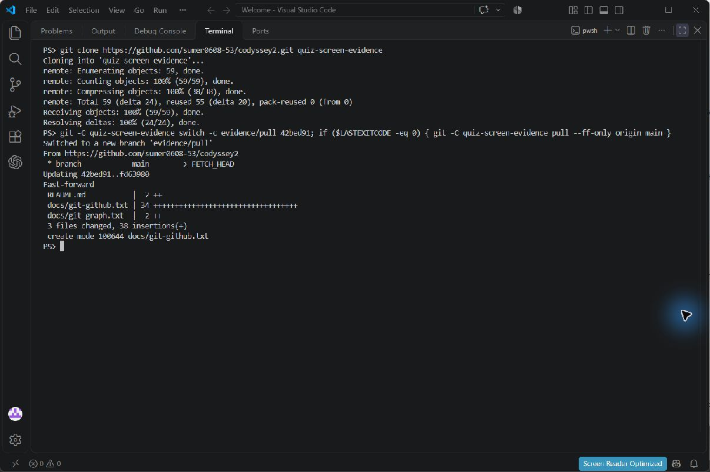

# 파이썬 한 문제

터미널에서 Python 기초 문제를 풀고, 직접 문제를 추가할 수 있는 퀴즈 게임이다. 자료형, 반복, 문자열과 예외 처리를 주제로 삼아 퀴즈를 풀면서 프로그램에 쓰인 문법도 함께 복습할 수 있도록 했다.

## 실행

Python 3.10 이상이 필요하다. 설치할 외부 패키지는 없다. Windows에서는 **start-quiz.cmd를 더블클릭**한다. 터미널에서는 프로젝트 루트에서 다음 명령을 실행한다.

~~~bash
python main.py
~~~

환경에 따라 `python3 main.py` 또는 Windows의 `py -3 main.py`를 사용한다.

## 기능

1. **퀴즈 풀기** · Python 기본 문제 6개와 추가한 문제를 모두 풀고 정오답과 점수를 확인한다.
2. **퀴즈 추가** · 문제, 선택지 4개, 1~4 사이 정답 번호를 등록한다.
3. **퀴즈 목록** · 저장된 문제를 번호와 함께 표시한다.
4. **점수 확인** · 최고 점수를 0~100점으로 표시한다. 풀기 전에는 별도 안내를 표시한다.
5. **종료** · Ctrl+C와 입력 종료(EOF)도 처리한다. 저장하지 못한 변경은 종료 시 다시 저장을 시도한다.

입력 앞뒤 공백을 제거한다. 숫자 변환 실패, 빈 입력, 범위 밖 입력은 안내 후 다시 입력받는다. 퀴즈가 없으면 풀이와 목록에서 안내한다. 점수는 정답 수 × 100 ÷ 문제 수의 정수 부분이다.

기본 문항을 바꾸면 `questions.py`의 `default_quizzes()`와 이 문서의 기본 문항 수를 같은 커밋에서 갱신하고, 저장 파일이 없는 새 작업본에서 목록과 풀이를 확인한다. 기존 `state.json`이 있는 작업본은 저장된 목록을 사용한다.

## 파일 구조

~~~text
.
├── start-quiz.cmd  Windows 더블클릭 실행
├── main.py         프로그램 진입점
├── game.py         QuizGame 클래스와 메뉴·게임 기능
├── quiz.py         Quiz 클래스와 데이터 검증
├── prompts.py      숫자·문자 입력 검증
├── questions.py    기본 문제 6개
├── storage.py      UTF-8 JSON 저장·복구
├── docs/           게임 실행·환경·Git 검증 기록
└── state.json      실행 중 생성되는 로컬 데이터
~~~

## 저장 데이터

`state.json`은 실행 위치와 관계없이 `main.py` 옆에서 읽고 쓴다. `quizzes`에 `question`, `choices`, `answer`를 저장하고 `best_score`에 최고 점수를 저장한다. 아직 푼 적이 없으면 `best_score`는 `null`이다.

파일이 없으면 기본 문제를 사용한다. JSON이 손상됐거나 형식이 맞지 않으면 안내한 뒤 기본 문제로 시작한다. 퀴즈 추가나 최고 점수 갱신 때 임시 파일에 먼저 쓴 뒤 교체한다. 개인 실행 데이터인 `state.json`은 Git에서 제외한다.

저장 순서는 **같은 폴더에 임시 파일 생성 → UTF-8 JSON 기록 → 파일 닫기 → `state.json` 교체 → 남은 임시 파일 정리**다. 교체 전에 쓰기가 실패하면 이전 저장 파일을 그대로 읽을 수 있다.

자동 저장에 실패하면 게임이 쓰기 권한 확인을 안내하고 메모리의 변경을 유지한다. 안내가 뜨면 폴더 권한이나 디스크 상태를 확인한 뒤 종료한다. 메뉴 종료, Ctrl+C, EOF 모두 종료 전에 저장을 한 번 더 시도한다. 종료 시에도 실패하면 저장 오류 메시지가 다시 표시되고, 재실행 시 마지막으로 저장에 성공한 내용만 불러온다. 새 파일도 만들 수 없었다면 기본 문제로 시작한다. [오류별 대응과 복구 방법](docs/state-recovery.md)

파일 손상 시 기존 기록이 필요하면 원본을 별도 이름으로 복사한 뒤 정상 백업으로 복원한다. 기본 문항부터 다시 시작하려면 게임을 닫고 기존 파일을 `state.broken.json` 등으로 이름을 바꾼 다음 실행한다.

### JSON을 선택한 이유와 한계

`quizzes`를 객체 배열로 두면 문항 순서를 유지하면서 문제·선택지·정답을 문항 단위로 함께 검증하고 저장할 수 있다. 세 필드를 별도 배열로 나눌 때 생길 수 있는 인덱스 불일치를 줄인다. 전체 게임의 최고 점수는 개별 문항에 속하지 않으므로 최상위에 둔다.

JSON은 사람이 편집기로 읽을 수 있고, 퀴즈 객체의 배열과 각 객체의 선택지 배열을 구조 그대로 표현한다. Python 표준 라이브러리로 읽고 쓸 수 있으며, UTF-8과 `ensure_ascii=False`로 한글을 그대로 보존한다. 다만 현재 구현은 시작할 때 파일 전체를 메모리에 읽고, 저장할 때 전체 파일을 다시 쓴다. 문항이나 기록이 많아지면 시작·저장 시간과 메모리 사용량이 늘고, 여러 프로세스가 동시에 쓰면 마지막 저장이 앞선 변경을 덮을 수 있다. 데이터가 커지면 SQLite에 문항과 점수를 나눠 저장해 필요한 행만 읽고, 트랜잭션으로 변경할 수 있다.

## 클래스 선택 이유

`Quiz`는 문제·선택지·정답 번호와 그 검증·채점 동작을 한 객체에 묶는다. 생성 때 네 개의 선택지와 유효한 정답 번호를 검사한다. `frozen=True`는 생성 후 속성을 다시 대입하지 못하게 하지만, 내부 선택지 리스트까지 불변으로 만들지는 않는다. `QuizGame`은 퀴즈 목록, 최고 점수, 저장 경로를 인스턴스에서 관리한다. 함수만으로도 구현할 수 있지만, 여러 화면이 같은 상태를 갱신하므로 클래스로 묶어 두면 매번 상태를 인자로 넘길 필요가 줄고 경로가 다른 게임을 독립적으로 만들 수 있다. 상태를 보유하지 않는 입력 검증과 JSON 변환은 함수로 분리했다.

## 요구사항별 변경 지점

`Quiz.show()`는 문항과 선택지를 출력하고 `Quiz.is_correct()`는 번호를 비교한다. `QuizGame.play()`는 여러 문항의 풀이와 점수 갱신을 조율하고, `add_quiz()`는 입력을 모아 새 문항을 등록한다.

입력을 받아 공백과 범위를 확인하는 규칙은 `prompts.py`에, 파일 경로로 JSON을 읽고 쓰는 처리는 `storage.py`에 둔다. 게임 진행과 저장을 요청하는 시점은 `game.py`가 결정하고, 문항 자체의 유효성은 `Quiz`가 보장한다.

입력 오류 문구를 통일할 때는 빈 입력, 숫자 변환 실패, 범위 오류의 한국어 문구를 `prompts.py`의 상수에 모으고, 범위 메시지는 최솟값과 최댓값을 템플릿에 전달한다. 여러 언어가 필요해지면 같은 메시지 키를 언어별 사전에서 조회하고 입력 검증 규칙은 그대로 공유한다.

| 바꿀 기능 | 파일과 클래스·함수 |
| --- | --- |
| 메뉴 문구, 번호 및 기능 연결 | `game.py`의 `MENU`, `QuizGame.run()` |
| 입력 범위·공백·재입력 규칙 | `prompts.py`의 `ask_number()`, `ask_text()` |
| 기본 문제와 선택지·정답 검증 | `questions.py`의 `default_quizzes()`, `quiz.py`의 `Quiz.__post_init__()` |
| 출제 순서, 정오답, 점수 계산 | `game.py`의 `QuizGame.play()`, `quiz.py`의 `Quiz.show()`, `Quiz.is_correct()` |
| 퀴즈 등록·목록 출력 | `game.py`의 `QuizGame.add_quiz()`, `QuizGame.list_quizzes()` |
| 최고 점수 출력·갱신 | `game.py`의 `QuizGame.show_score()`, `QuizGame.play()` |
| 저장 경로, JSON 구조, 복구 처리 | `main.py`의 상태 파일 경로, `game.py`의 `QuizGame.load()`·`save()`, `storage.py`의 `load_state()`·`save_state()` |

## Git 작업 규칙과 브랜치

- 한 커밋에는 한 가지 변경 목적을 담는다. 메뉴·문항 모델·출제·등록·JSON 저장처럼 기능별로 나누고, 검증 가능한 상태에서 커밋한다.
- 메시지는 `유형: 변경 요약`으로 작성한다. 기능은 `Feat:`, 오류 수정은 `Fix:`, 내부 구조 개선은 `Refactor:`, 문서는 `Docs:`, 초기 설정은 `Chore:`를 사용한다. 예를 들어 `Feat: persist questions and scores to UTF-8 JSON`처럼 무엇을 바꿨는지 적는다.
- 출제 흐름은 `feature/quiz-play`에 분리해 메뉴와 기본 문제 데이터가 있는 `main`을 유지하면서 정오답·결과 표시를 구현했다. 기능 구현을 마친 시점에 `main`에서 `git merge --no-ff feature/quiz-play`로 통합했다. 병합 커밋은 어느 브랜치의 기능을 언제 본선에 합쳤는지 이력에 남긴다. [병합 커밋](https://github.com/sumer0608-53/codyssey2/commit/ec256b1)
- `main`은 실행 가능한 제출 기준으로 유지한다. 기능은 `feature/<기능명>`, 오류 수정은 `fix/<문제명>` 브랜치에서 작업한다. 해당 기능과 기존 주요 실행 흐름을 확인한 뒤 `main`에 병합한다. 기능 브랜치의 이력을 남겨야 할 때는 `--no-ff`를 사용한다.

### 커밋 수와 확인 위치

첫 평가 보완본 `f398aeb`까지 `main`에서 도달 가능한 커밋은 병합 커밋을 포함해 **17개**였다. 현재 수는 `git rev-list --count main`, 병합 흐름은 `git log --oneline --graph --all`로 확인한다. [GitHub main 커밋 목록](https://github.com/sumer0608-53/codyssey2/commits/main/) · [실제 Git 작업 기록](docs/git-github.txt)

복제한 작업 폴더에서 게임을 실행해도 저장 데이터는 해당 복제본에 따로 생성된다.

## 검증 기록

- [게임 실행 출력](docs/game-run.txt)에서 문제 추가, 목록, 풀이 결과와 다시 불러온 최고 점수를 확인할 수 있다.
- [Python·Git 버전과 기능 검증](docs/verification.txt)에는 입력 예외, 재시작 후 데이터 유지, 저장 오류 복구를 확인한 결과가 있다.
- [Git 브랜치·병합 그래프](docs/git-graph.txt)와 [로컬 복제·푸시·풀 기록](docs/git-local.txt)을 남겼다. 복제 실습에는 로컬 bare 저장소를 사용했다.
- [게임 시연 스크린샷](docs/game-run.jpg)은 실제 게임 코드에 자동 입력을 공급해 등록, 목록, 풀이 결과, 재시작 후 최고 점수를 확인한 화면이다.
- [환경과 Git 그래프 스크린샷](docs/environment-git-graph.jpg)은 VS Code 터미널에 Python·Git 버전과 `git log --oneline --graph --all`을 출력한 화면이다.

GitHub에서 별도로 복제한 작업본에서 이 문구를 추가해 푸시하고, 원래 작업본에서 빠른 병합으로 가져오는 흐름을 확인했다.

[GitHub에서 실제로 실행한 원격 연결·push·clone·pull 로그](docs/git-github.txt)에서 각 명령과 결과를 확인할 수 있다.

### GitHub clone·pull 실행 화면

VS Code 터미널에서 GitHub 저장소를 새 폴더에 복제했다. 변경을 받아오는 과정을 다시 확인하기 위해 복제본에 이전 커밋 `42bed91`을 기준으로 임시 브랜치를 만들고, `git pull --ff-only origin main`으로 `fd63980`까지 가져왔다. 화면에 복제 완료, 두 커밋 사이의 업데이트, `Fast-forward`가 표시된다.

